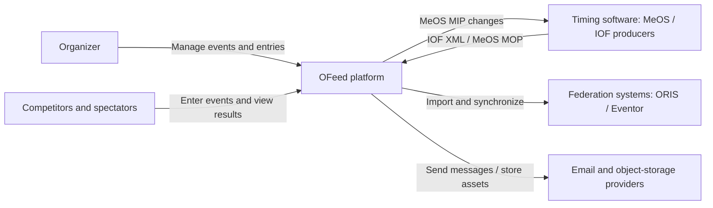
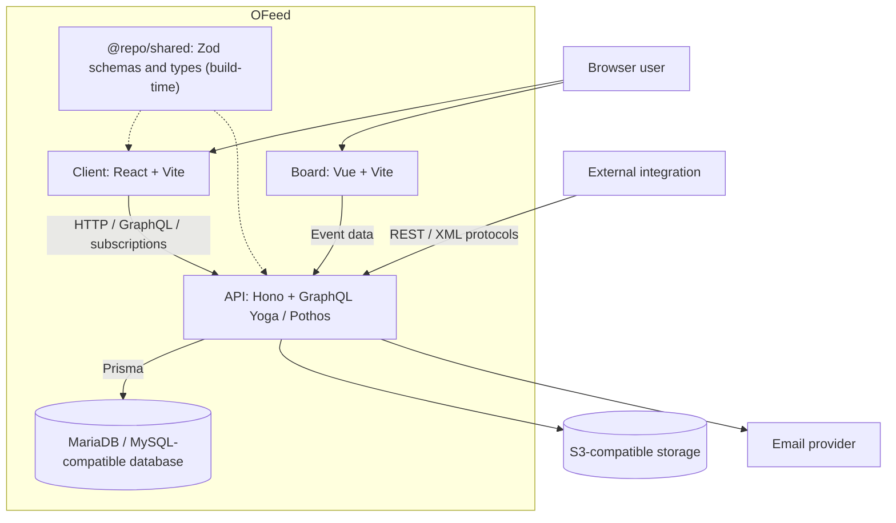

# Architecture overview

OFeed is a TypeScript monorepo with three applications and shared contracts. The
diagrams show logical boundaries, not a promise of a particular production
topology. Read [accepted ADRs](adr/README.md) before changing those boundaries.

## C4 context

## C4 containers

## Main data flows

1. Browser operations reach REST or GraphQL adapters, which call feature
   services. Services own business rules, authorization decisions and
   persistence.
2. Imports validate external input, translate it into event-scoped entities and
   publish relevant result updates. See [integrations](integrations.md).
3. Checkout validates the entry window, class eligibility/capacity, start slots
   and payment method, computes fees and stores an order. Competitors are
   created through approval/processing, not merely by returning payment
   instructions.
4. Live GraphQL updates use the process-local PubSub in
   [pubsub.ts](../../apps/server/src/lib/pubsub.ts). Multiple API replicas do
   not automatically share those messages. Evaluate fan-out and reconciliation
   before assuming horizontal scaling preserves live delivery.

## Code ownership

- [Client instructions](../../apps/client/AGENTS.md)
- [Server instructions](../../apps/server/AGENTS.md)
- [Board instructions](../../apps/board/AGENTS.md)
- [Shared-contract instructions](../../packages/shared/AGENTS.md)
- [Detailed GraphQL boundaries](../GRAPHQL_ARCHITECTURE.md)
- [Data model](data-model.md), [deployment](../ops/deployment.md)
